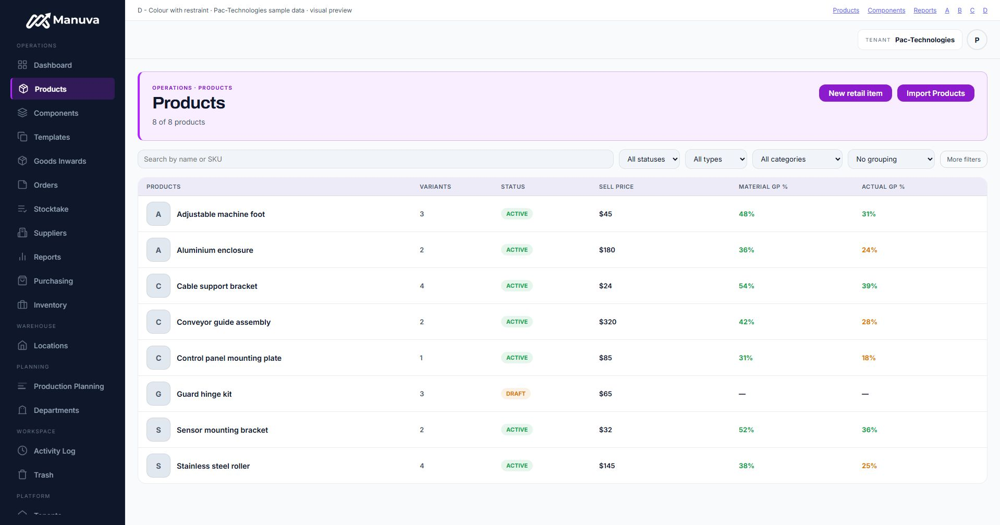
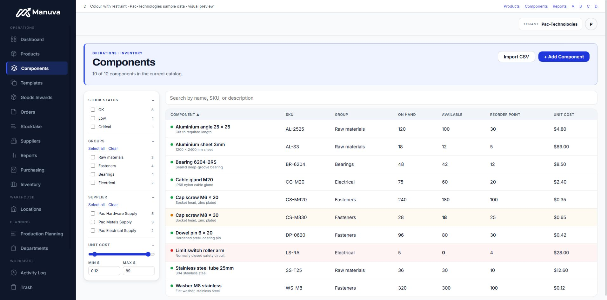
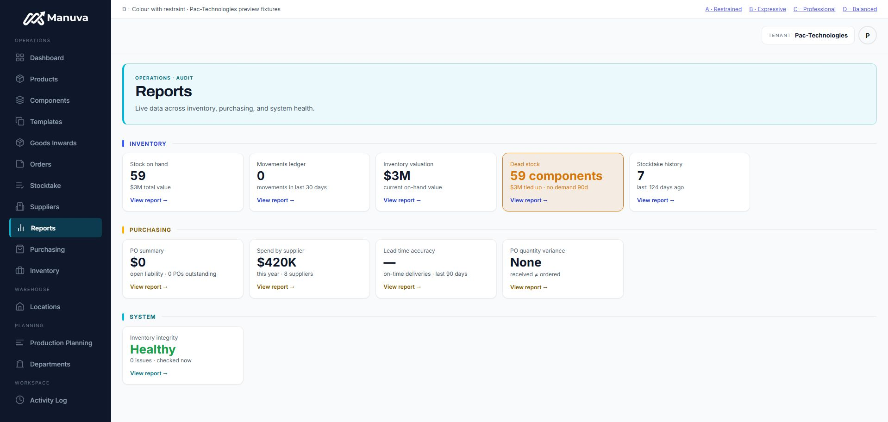
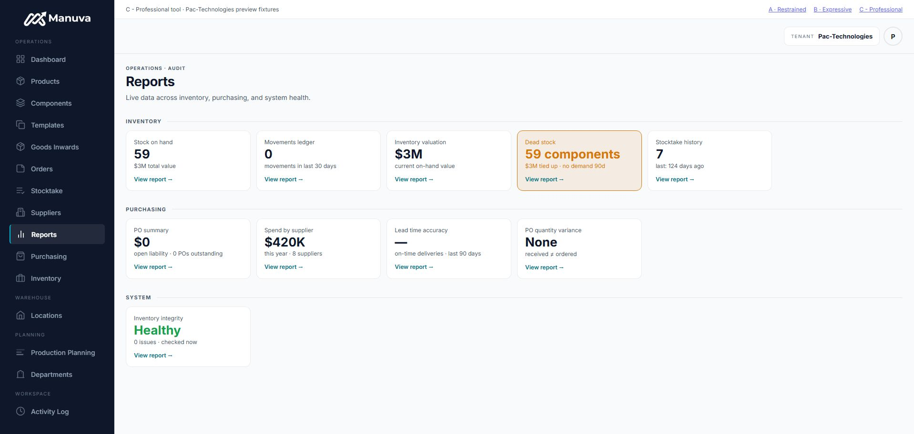
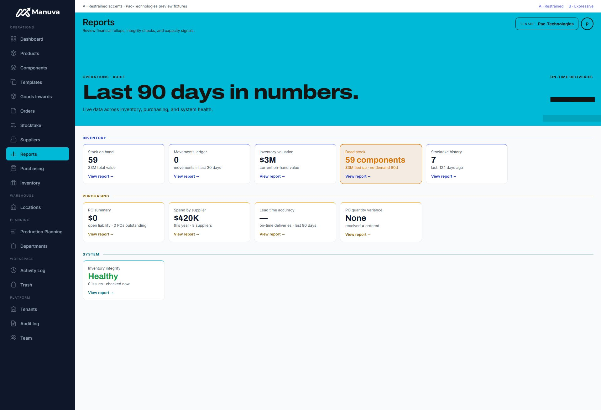
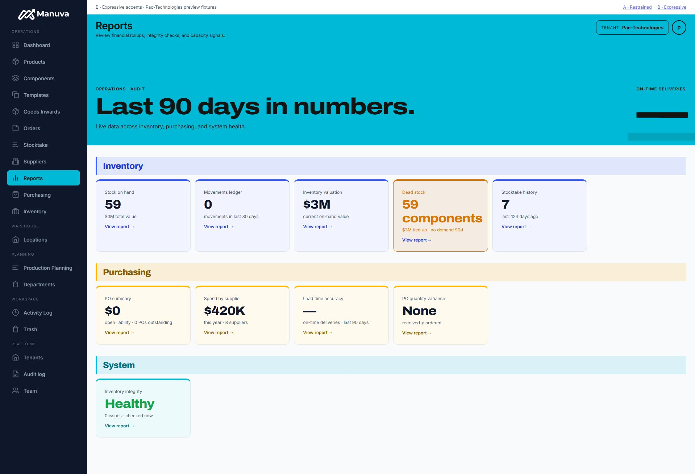

# Approved balanced app direction

## Products and Components examples

Approved by the user after reviewing these examples on 2026-10-13.
Requested next by the user: show D on denser catalogue screens. These use each
page's real return JSX, child components, CSS Modules and shell, with isolated
sample data and action/navigation boundaries. No live tenant queries or writes.

- [Products preview](http://127.0.0.1:3218/?variant=balanced&screen=products): violet identity, softly tinted header/table heading, compact title and neutral rows.
- [Components preview](http://127.0.0.1:3218/?variant=balanced&screen=components): blue identity, existing filter rail and flat table, low/critical stock rows retain semantic colours.

Both were inspected on desktop in all four themes: correct selected navigation,
32px heading, no page overflow; header eyebrow contrast is at least 5.96:1 for
Products and 5.75:1 for Components. Filters/sorting are visual-only fixture
controls; business actions return a preview-only error. Dialogs use real UI with
stubbed actions. This is not an authenticated app QA pass or a production rollout.
The fixture bundler warns about existing filter-rail `composes` display order;
desktop layout was inspected, but mobile drawer behaviour was not assessed here.

`node scripts/preview-reports-accents.mjs --build-only` refreshes generated assets
without starting a second server. Catalogue boundaries live in
`scripts/preview-catalog-fixtures.mjs`; production page source is untouched.

Requested by the user on 2026-10-13, MANUVA-117. These are product UI previews,
with the same explicitly labelled Pac-Technologies fixtures. No live writes or
production styling changes were made for this comparison.

| Direction | Accent treatment |
| --- | --- |
| A — restrained | Small uppercase section labels, fine domain rules, coloured links, narrow card accents. |
| B — expressive | Tinted section-heading areas and cards, larger Archivo labels/numerals, stronger accent rules. |
| C — professional tool | Neutral topbar and page heading, 28px Inter title, quiet section rules/cards, one consistent link accent and a small selected-navigation marker. |
| D — colour with restraint | Soft aqua header with a narrow accent edge, compact 32px Archivo title, coloured section markers/links and a tinted selected-navigation state. Cards remain neutral. |

After comparing A and B, the user chose constrained styling and explained that
bold marketing colours feel less appropriate for a professional working tool.
C follows that direction; warning and healthy states retain their semantic colours.
On reviewing C, the user said it felt too void of colour and unfinished. D restores
some visual identity while retaining a compact professional working layout. D is
an example for review, not an accepted direction or a production implementation.

Both close the Reports cover's 32px gap beneath the topbar and remove the 1200px
page cap. The defect was reproduced in the existing signed-in Pac-Technologies
tab: cover 1168px wide versus topbar 1678px, caused by `.page`'s extra
`padding: 32px 40px`. Earlier shared-header verification missed the actual wrapper.

Preview links (while the local server runs):

- [C — professional tool](http://127.0.0.1:3218/?variant=professional)
- [D — colour with restraint](http://127.0.0.1:3218/?variant=balanced)
- [A — restrained](http://127.0.0.1:3218/?variant=restrained)
- [B — expressive](http://127.0.0.1:3218/?variant=expressive)

Run `node scripts/preview-reports-accents.mjs` to rebuild the comparison from
the actual Reports JSX, wrapper, shared header, shell and CSS. Requires installed
dependencies and a local Next build for its existing Archivo/Inter font assets.
The generator replaces only server data/navigation/action boundaries with fixture
inputs; business actions are not wired. `?theme=midnight`, `ocean` or `ember` previews
the dark themes without changing user preferences.

Verified: both variants have zero band gap, equal band widths and no horizontal
overflow across four themes. Normal report-link contrast is at least 5.79:1 for A
and 5.43:1 for B; existing semantic warning/success states retain their roles.
The proposed shared index accents use the published `--accent-text`/`--accent-dim`
tokens, including their dark-theme shades. Quiet record headers retain their styling.

C was also inspected in Chrome across all four themes: no coloured content band,
28px title, no horizontal overflow; normal report-link contrast is at least 5.79:1.
These contrast measurements concern normal links, not every pre-existing status label.

Latest feedback: C needs more colour. D is the revised example awaiting review.
D was checked in four themes: no horizontal overflow; header eyebrow contrast
is at least 5.39:1 and normal report-link contrast at least 5.79:1. Small domain
markers and labels identify report sections; warning/health states retain their
semantic colours. No backend actions or live customer data are used.

The comparison and
initial A source changes are local drafts, not the completed professional rollout.
C/D overrides live only in the preview generator; apply the chosen direction to shared
components and update the affected page map before publishing a new release.
Original deployed release remains `41321f8c`.

## Implementation

Balanced D is now the approved direction. The shared header/topbar/navigation and
scoped table accents implement it; Reports retains its corrected wrapper, section
markers and neutral cards. `?variant=implemented&screen=products` (or components/
reports) renders the real shared implementation without prototype styling overrides.
Original A/B/C/D screenshots above remain historical review evidence.
